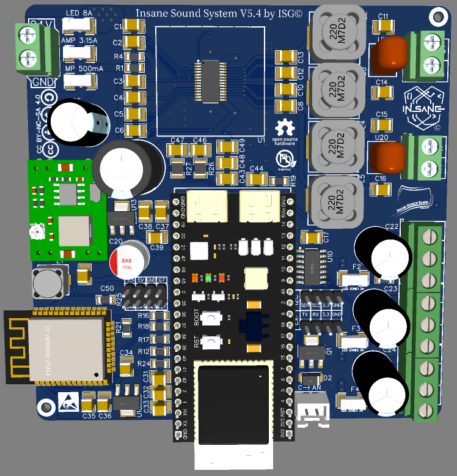
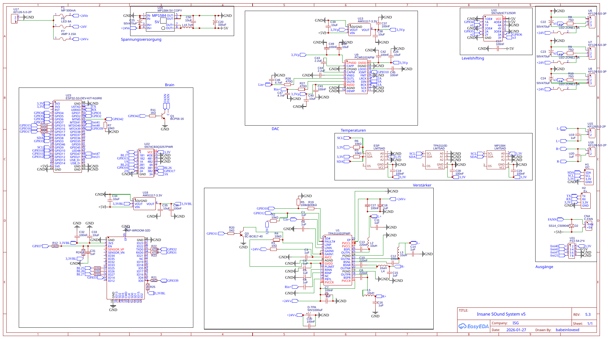

<p align="center">
  <a href="https://github.com/babeinlovexd"></a>
</p>

# Insane Sound System V5

[English](README_en.md) · [Fragen & Fehler](https://github.com/babeinlovexd/Insane-Sound-System/issues) · [Releases](https://github.com/babeinlovexd/Insane-Sound-System/releases)

**DIY-Audio-Controller mit ESP32-S3 und ESP32-WROOM** für WLAN-Wiedergabe, Bluetooth-Audio, Beleuchtung und Temperaturregelung mit ESPHome und Home Assistant.

<p align="center"></p>

## Funktionen

- ESP32-S3 für ESPHome, Netzwerkaudio und Steuerung; WROOM für Bluetooth A2DP und Metadaten.
- I2S-Quellenumschaltung per SN74CB3Q3257, DAC-/Verstärkersteuerung und Hardware-Gain-Option.
- Bis zu drei LED-Zonen über optionale WS2811-, WS2814- oder WS2805-Pakete.
- Drei Temperatureingänge, PWM-Lüfterregelung und Abschaltlogik.
- Optionales OLED-/Tasten-Frontpanel und das Desktop-Tool InsaneFlasher.

Bluetooth A2DP ist ein drahtloser Audioeingang, keine Zusicherung verlustfreier Übertragung. Umschaltverhalten und Störgeräusche hängen vom gesamten Hardwareaufbau, der Verkabelung und Firmwarekonfiguration ab.

## Hardware & Dateien

Das V5-Design nutzt eine 100 × 100-mm-Platine mit ESP32-S3, WROOM-Modul, I2S-Multiplexer, DAC und TPA3110-Verstärkersteuerung. Passive SMD-Bauteile sind als 1206 beschrieben; ICs und freiliegende Masseflächen benötigen weiterhin passende Lötausrüstung und Erfahrung.

- [BOM](BOM): Stücklisten und Bestückungshilfe.
- [Gerber](Gerber): Fertigungsdaten der Platine.
- [Images](Images): Schaltplan, Layout und Ansichten.
- [ESPHome/insane-sound-system-v5.yaml](ESPHome/insane-sound-system-v5.yaml): Hauptkonfiguration.
- [Packages](Packages): LED- und Frontpanel-Konfigurationen.
- [Arduino/insane_bl_v5.ino](Arduino/insane_bl_v5.ino): Bluetooth-Firmwarequellcode.

Zusammengehörige Hardware- und Firmwarestände verwenden. Eine Firmware-Versionsnummer bezeichnet nicht automatisch eine Platinenrevision.

## Installation

1. Platine nach zugehöriger Stückliste und Schaltplan aufbauen und prüfen. Versorgungen vor dem Anschließen von Audio- und LED-Lasten kontrollieren.
2. Die Haupt-YAML in den ESPHome-Konfigurationsordner kopieren.
3. Eine lokale `secrets.yaml` mit `api_encryption_key`, `ota_password`, `wifi_ssid`, `wifi_password`, `ap_password`, `web_server_username` und `web_server_password` anlegen.
4. `ha_player_id` anpassen. Nur das zum eingebauten Streifentyp passende LED-Paket aktivieren; das Frontpanel-Paket nur bei vorhandener Hardware einschalten.
5. In ESPHome validieren und kompilieren, den S3 erstmals per USB flashen und in Home Assistant hinzufügen.
6. Die passende Bluetooth-Firmware installieren und beide Audioquellen prüfen, bevor Automationen und Beleuchtung eingerichtet werden.

Die YAML nutzt ESPHomes `speaker`-Audiopipeline. Maßgeblich sind der tatsächliche ESPHome-Build und das gewählte Framework, keine pauschale Zusage für jede neuere Version.

## InsaneFlasher

Die Windows-Datei gibt es in den [Releases dieses Repositories](https://github.com/babeinlovexd/Insane-Sound-System/releases). Alternativ [InsaneFlasher.py](InsaneFlasher/Linux_Mac/InsaneFlasher.py) aus seinem Verzeichnis starten:

```bash
python -m pip install customtkinter requests esptool zeroconf pillow packaging pyserial
python InsaneFlasher.py
```

Der S3 stellt für den Bluetooth-Chip eine Netzwerk-Seriell-Bridge auf Port **8888** bereit. Das Tool schaltet den Zielchip in den Bootloader und flasht ihn über diese Bridge. Das ist ein anderer Vorgang als das ESPHome-OTA-Update des S3 selbst. Die Bridge nur im vertrauenswürdigen lokalen Netz verwenden und Firmware für diese V5-Hardware auswählen.

## Fehlersuche

- **Kein Netzwerkaudio:** Home-Assistant-Player-ID, Speaker-Pipeline und S3-Logs prüfen.
- **Bluetooth ohne Metadaten:** Separate UART-Verbindung und Firmwarestände prüfen.
- **Flasher verbindet nicht:** Geräteerkennung, IP, Bridge-Port, Webserver-Zugang und Bootmodus-Steuerung prüfen.
- **LED-Konflikte:** Ein passendes LED-Paket aktivieren und GPIO-/RMT-Belegung prüfen.
- **Temperaturabschaltung:** Kühlung und Sensorwerte prüfen, bevor Grenzwerte verändert werden.

<p align="center"> </p>

## Lizenz

[CC BY-NC-SA 4.0](LICENSE). Es gilt die bestehende Projektlizenz. Drittanbieter-Komponenten behalten ihre jeweiligen Lizenzen.

---

## Builds und Releases

Version: **5.5.9** ([VERSION](VERSION)). [GitHub Actions](.github/workflows/release.yml) prüft Pushes und Pull Requests. Ein Tag passend zu `v` + `VERSION` veröffentlicht das Release erst nach erfolgreichen Jobs; manuelle Läufe liefern Build-Artefakte. [Downloads](https://github.com/babeinlovexd/Insane-Sound-System/releases).

ESPHome-CI verwendet Platzhalter-Zugangsdaten und flasht keine Geräte. Vor dem Einsatz eigene Secrets und Pinbelegung prüfen.

## Mitmachen

Fragen, Fehlerberichte und Beiträge sind willkommen. Nenne Version, Aufbau und Schritte zum Nachstellen im [Issue](https://github.com/babeinlovexd/Insane-Sound-System/issues). Größere Änderungen besprechen wir am besten vor einem Pull Request.

Dieses Hobbyprojekt unterstützen: [PayPal](https://www.paypal.me/babeinlovexd).

[BxD / BabeinlovexD](https://github.com/babeinlovexd) · [Website](https://babeinlovexd.de/)
