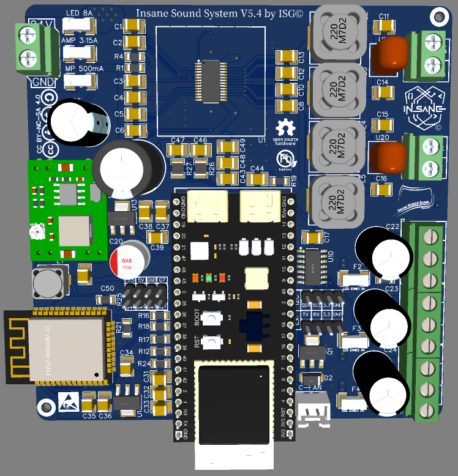
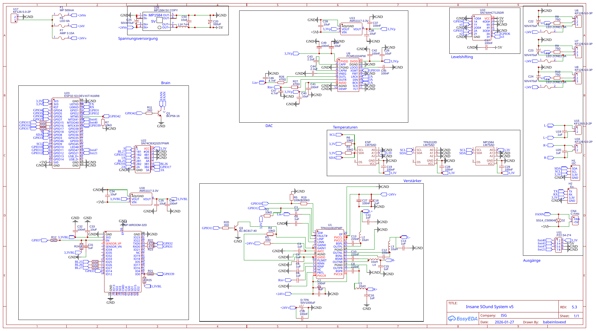

<p align="center">
  <a href="https://github.com/babeinlovexd"></a>
</p>

# Insane Sound System V5

[Deutsch](README.md) · [Issues](https://github.com/babeinlovexd/Insane-Sound-System/issues) · [Releases](https://github.com/babeinlovexd/Insane-Sound-System/releases)

A **DIY audio controller with ESP32-S3 and ESP32-WROOM**, integrating Wi-Fi playback, Bluetooth audio, lighting and temperature control through ESPHome and Home Assistant.

<p align="center"></p>

## Features

- ESP32-S3 for ESPHome, network audio and control; WROOM for Bluetooth A2DP and metadata.
- I2S source switching through SN74CB3Q3257, DAC/amplifier control and a hardware gain option.
- Up to three LED zones using optional WS2811, WS2814 or WS2805 packages.
- Three temperature inputs, PWM fan regulation and shutdown logic.
- Optional OLED/button front panel and an InsaneFlasher desktop tool.

Bluetooth A2DP is a wireless audio input, not a guarantee of lossless transmission. Switching behavior and noise depend on the complete hardware, wiring and firmware configuration.

## Hardware & files

The V5 design uses a 100 × 100 mm board with an ESP32-S3, WROOM module, I2S multiplexer, DAC and TPA3110-based amplifier control. Passive SMD components are described as 1206; ICs and exposed pads still require suitable soldering equipment and experience.

- [BOM](BOM): component lists and assembly reference.
- [Gerber](Gerber): PCB manufacturing files.
- [Images](Images): schematics, layout and renders.
- [ESPHome/insane-sound-system-v5.yaml](ESPHome/insane-sound-system-v5.yaml): main configuration.
- [Packages](Packages): LED and front-panel configurations.
- [Arduino/insane_bl_v5.ino](Arduino/insane_bl_v5.ino): Bluetooth firmware source.

Use matching hardware and firmware revisions; a firmware version number does not automatically identify a PCB revision.

## Installation

1. Assemble and inspect the board against its matching BOM/schematic. Check supply rails before connecting audio and LED loads.
2. Copy the main ESPHome YAML into your configuration directory.
3. Create a local `secrets.yaml` with `api_encryption_key`, `ota_password`, `wifi_ssid`, `wifi_password`, `ap_password`, `web_server_username` and `web_server_password`.
4. Adjust `ha_player_id` and enable only the LED package matching the installed strip type. Enable the front-panel package only when fitted.
5. Validate and compile in ESPHome, flash the ESP32-S3 over USB for the first setup, and add it to Home Assistant.
6. Install the matching Bluetooth firmware and verify both audio sources before configuring automations and lighting.

The YAML uses ESPHome's `speaker` audio pipeline. Check the current ESPHome build output and selected framework rather than assuming every newer version is compatible.

## InsaneFlasher

Use the Windows download from this repository's [Releases](https://github.com/babeinlovexd/Insane-Sound-System/releases), or run [InsaneFlasher.py](InsaneFlasher/Linux_Mac/InsaneFlasher.py) from its directory:

```bash
python -m pip install customtkinter requests esptool zeroconf pillow packaging pyserial
python InsaneFlasher.py
```

The S3 exposes a network serial bridge for the Bluetooth chip on port **8888**. The tool switches the target to bootloader mode and flashes it through that bridge. This is not the same as the S3's own ESPHome OTA update. Keep the bridge on the trusted local network and select the firmware for this V5 hardware.

## Troubleshooting

- **No network playback:** Check the Home Assistant player ID, speaker pipeline and S3 logs.
- **Bluetooth works but metadata does not:** Check the separate UART wiring and firmware versions.
- **Flasher cannot connect:** Check device discovery, IP, bridge port, web-server credentials and target boot-mode control.
- **LED conflicts:** Enable a single appropriate LED package and check GPIO/RMT allocation.
- **Temperature shutdown:** Inspect cooling and temperature readings before bypassing or changing thresholds.

<p align="center"> </p>

## License

[CC BY-NC-SA 4.0](LICENSE). The existing project license applies; third-party components retain their own licenses.

---

## Builds and releases

Version: **5.5.9** ([VERSION](VERSION)). [GitHub Actions](.github/workflows/release.yml) checks each push and pull request. A tag matching `v` + `VERSION` publishes a release after all jobs succeed; manual runs provide build artifacts. [Downloads](https://github.com/babeinlovexd/Insane-Sound-System/releases).

ESPHome CI uses dummy credentials and does not flash devices. Configure your own secrets and pin assignments before deployment.

## Contributing

Questions, bug reports and contributions are welcome. Include version, setup and reproduction steps in an [Issue](https://github.com/babeinlovexd/Insane-Sound-System/issues). Please discuss larger changes before a pull request.

Support this hobby project: [PayPal](https://www.paypal.me/babeinlovexd).

[BxD / BabeinlovexD](https://github.com/babeinlovexd) · [Website](https://babeinlovexd.de/)
